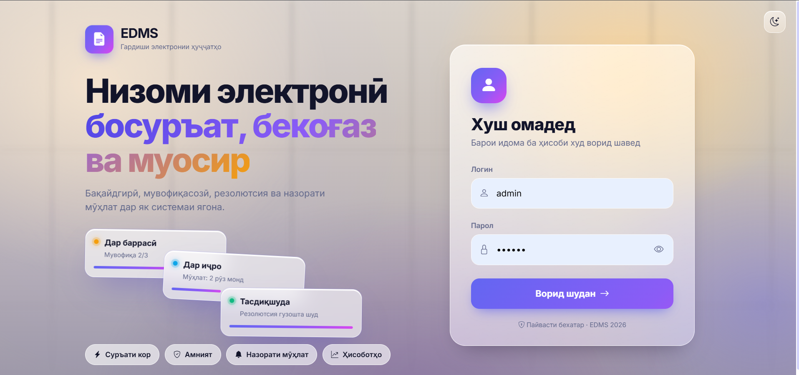
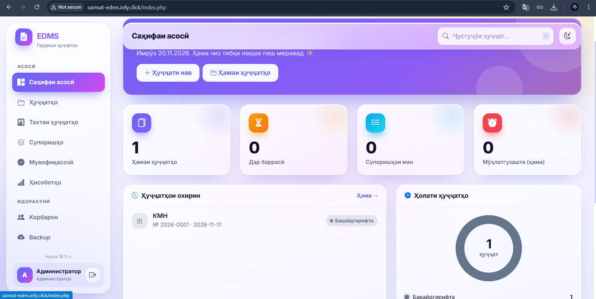
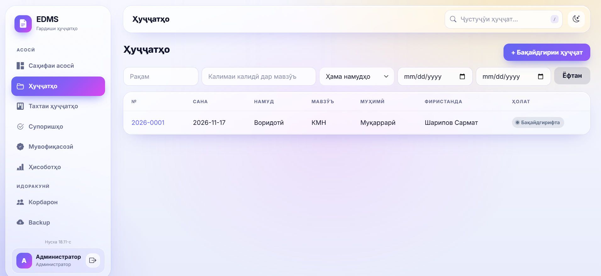
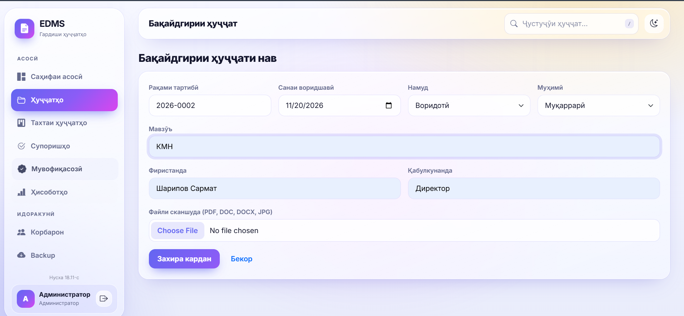
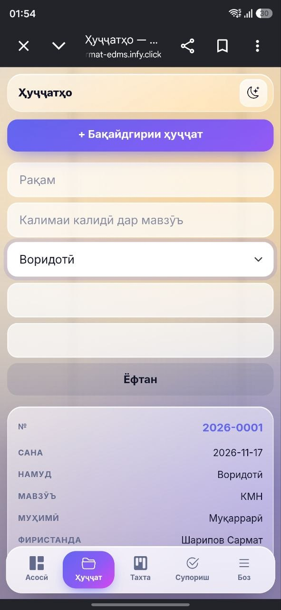

# UI-kit: EDMS (Низоми идоракунии ҳуҷҷатҳо ва вазифаҳо)

## 1. Сетка ва фосилаҳо (Layout Grid & Spacing)

* **Desktop (`1440px`):** сеткаи 12-сутуна (`Count: 12`, `Type: Center`, `Width: 88px`, `Gutter: 24px`, паҳнои мундариҷа `1320px` — мувофиқи `.container`-и Bootstrap 5.3)[cite: 10, 39, 41].
* **Tablet (`768px`):** сеткаи 12-сутуна (`Gutter: 24px`)[cite: 11].
* **Mobile (`390px`):** сеткаи 4-сутуна (`Stretch`, `Margin: 16px`, `Gutter: 16px`)[cite: 11, 41].
* **Шакли қадами отступҳо:** `4px / 8px / 12px / 16px / 24px / 32px` (қадами асосӣ ба 4 ва 8 баробар аст)[cite: 10, 41, 43].

---

## 2. Токенҳои рангӣ ва тафтиши контраст (WCAG 2.2 AA)

Талаботи ҳадди ақали контраст: барои матни муқаррарӣ на камтар аз `4.5:1`, барои сарҳади майдонҳо ва нишондиҳандаҳои фокус на камтар аз `3:1`[cite: 14, 76]. Рангҳо ҳамчун тағйирёбанда дар `:root` ва `--bs-*` дар `public/assets/css/app.css` истифода мешаванд[cite: 24, 31, 45, 46].

| Токен дар Figma | HEX | Тағйирёбандаи CSS | Таъинот ва санҷиши контраст (WCAG AA) |
| :--- | :--- | :--- | :--- |
| `color/primary` | `#1d4ed8`[cite: 10, 75] | `--edms-primary` / `--bs-primary`[cite: 10, 24, 46] | Тугмаҳои асосӣ, пайвандҳо, фокус[cite: 10, 75] |
| `color/primary-hover` | `#1e40af`[cite: 10] | `--edms-primary-hover`[cite: 10] | Ҳолати Hover барои унсурҳои асосӣ[cite: 10, 14] |
| `color/navbar` | `#1e3a5f`[cite: 10] | `--edms-navbar-bg`[cite: 10] | Заминаи панели болоии навигация[cite: 10] |
| `color/text` | `#1f2937`[cite: 10, 75] | `--edms-text` / `--bs-body-color`[cite: 10, 24, 46] | Матни асосӣ[cite: 10, 75] |
| `color/text-muted` | `#4b5563`[cite: 11, 14] | `--edms-text-muted`[cite: 11] | Матни дуюмдараҷа ва эзоҳҳо[cite: 11, 14] |
| `color/bg` | `#f5f7fa`[cite: 11, 14] | `--edms-bg` / `--bs-body-bg`[cite: 11, 24, 46] | Заминаи умумии саҳифа[cite: 11, 14] |
| `color/surface` | `#ffffff`[cite: 11] | `--edms-surface`[cite: 11] | Кортҳо, ҷадвалҳо, блокҳои мундариҷа[cite: 11, 14] |
| `color/border` | `#d1d5db`[cite: 11, 14] | `--edms-border` / `--bs-border-color`[cite: 11, 24, 46] | Сарҳадҳои ороишии кортҳо ва ҷадвалҳо[cite: 11, 14] |
| `color/input-border` | `#8a94a6`[cite: 11, 14] | `--edms-input-border`[cite: 11] | Сарҳади майдонҳои воридот ($\ge 3:1$)[cite: 11, 14] |
| `color/success` | `#15803d`[cite: 11] | `--edms-success`[cite: 11] | Ҳолати муваффақ / тасдиқшуда[cite: 11] |
| `color/warning` | `#b45309`[cite: 11] | `--edms-warning`[cite: 11] | Дар баррасӣ / интизорӣ[cite: 11] |
| `color/danger` | `#b91c1c`[cite: 11, 75] | `--edms-danger`[cite: 11, 75] | Хатогӣ, радшуда, амали хатарнок[cite: 11, 14, 75] |

---

## 3. Типографика (Typography)

* **Шрифти асосӣ:** `Noto Sans` (бо дастгирии пурраи кириллика ва аломатҳои зарурӣ; пеш аз истифода бо матни санҷишӣ тафтиш шудааст)[cite: 10, 11].
* **Услубҳои матн:**
  * `Heading / H1`: `28/36` (SemiBold) ё `32/40`[cite: 11, 40]
  * `Heading / H2`: `22/30` (SemiBold) ё `24/32`[cite: 11, 40]
  * `Body / Regular`: `16/24` (Regular)[cite: 11, 40]
  * `Body / Small`: `14/20` (Regular)[cite: 11, 40]
  * `Label`: `14/20` (Medium)[cite: 11]

---

## 4. Компонентҳо ва ҳолатҳо (Components & States)

* **Button (`Primary`, `Secondary`, `Danger`):** ҳолатҳои `Default`, `Hover`, `Focus` (контури намоёни фокус), `Disabled`; баландии қулай барои клик; мутобиқ ба `.btn`, `.btn-primary`, `.btn-outline-secondary`, `.btn-danger` дар Bootstrap 5.3[cite: 9, 13, 14, 26, 40, 42, 46]. Дар ҳар экран танҳо як тугмаи асосии `Primary` истифода мешавад[cite: 13].
* **Input:** дорои `<label>`-и равшан (`placeholder` танҳо ҳамчун намунаи навишт аст, на ивазкунандаи `<label>`); ҳолатҳои `Default`, `Focus`, `Error` (сарҳади хатогӣ + матни фаҳмои хатогӣ), `Disabled`; мутобиқ ба `.form-control` ва `.is-invalid`[cite: 15, 26, 40, 42].
* **Badge / Status:** статус ҳамеша бо матни фаҳмо нишон дода мешавад (на танҳо бо ранг)[cite: 13, 14, 15].
* **Card:** корти маълумот/ҳуҷҷат бо `Auto Layout`, ки ҳангоми тағйири ҳаҷми матн дуруст васеъ мешавад[cite: 8, 9, 26, 40, 42, 43].
* **Modal:** равзанаи тасдиқ барои амалҳои хатарнок (масалан, нест кардан)[cite: 6, 13, 26, 42].

### Мутобиқати статусҳои низом ба имзоҳои тоҷикӣ

| Статус дар система/БД | Имзо барои корбар | Таъинот |
| :--- | :--- | :--- |
| `registered` | Бақайдгирифта | Ҳуҷҷат сабт шудааст |
| `review` | Дар баррасӣ | Дар марҳилаи санҷиш/мувофиқа |
| `in_progress` | Дар иҷро | Иҷрокунанда кор карда истодааст |
| `approved` | Тасдиқшуда | Тасдиқ шуд |
| `rejected` | Радшуда | Рад ё баргардонида шуд |
| `done` | Иҷрошуда | Иҷро пурра ба анҷом расид |

---

## 5. Скриншотҳои макетҳо (`screens/`)

* [cite: 41]
* [cite: 41]
* [cite: 41]
* [cite: 41]
* [cite: 41]